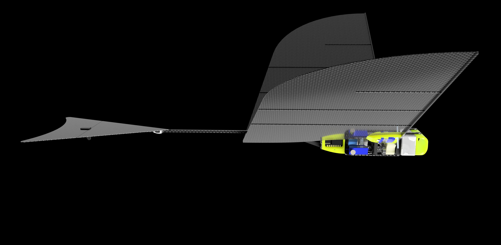

{#fig-faav}

Over the semester your team builds a **flapping aerial-aquatic vehicle**: a
robot that flies, lands on water, swims by flapping the same wings, and takes
off again. This manual is the build side of the course. It is sequenced to the
weekly sessions, and each page covers exactly what you do in that session.

## How this manual is organised

**Build sessions** are cumulative and in order. Each one opens with what you
are building that day, what to have ready before you arrive, and ends with a
checkpoint a TA signs off.

**Reference** holds the material you consult rather than follow: the parts
list, the firmware repositories, the PCB revisions, the CNC guide, and the
design notes explaining why the robot is the way it is.

## Semester map

| Session | Week | Build | Paired lecture |
|---:|---|---|---|
| [1](sessions/01-orientation.qmd) | Sep 9 | Orientation, teams, the robot | Intro to robotic locomotion |
| [2](sessions/02-motor.qmd) | Sep 14 | Motor and transmission shaft | Reaction forces in fluids |
| [3](sessions/03-esc.qmd) | Sep 21 | Motor driver, sensor, serial | Bird-scale flapping design |
| [4](sessions/04-control.qmd) | Sep 28 | Closed-loop control and tuning | Swimming robots I |
| [5](sessions/05-frame-crank.qmd) | Oct 5 | Frame, crank, linkage, gears | Undulatory locomotion |
| — | Oct 12 | *No session* | — |
| [6](sessions/06-simulation.qmd) | Oct 19 | Flapping simulation (Ptera) | Insect-scale flapping |
| [7](sessions/07-wings.qmd) | Oct 26 | Wing fabrication | Swimming robots II |
| [8](sessions/08-tail-housing.qmd) | Nov 2 | Tail and housing | Multi-modal locomotion |
| [9](sessions/09-electronics-dry-test.qmd) | Nov 9 | Flight controller, PCB, dry testing | The future of actuation |
| [10](sessions/10-waterproofing.qmd) | Nov 16 | Waterproofing | Multirotors |
| [11](sessions/11-wet-testing.qmd) | Nov 23 | Wet testing | Fixed-wing flyers |
| [12](sessions/12-competition.qmd) | Nov 30 | Competition | Pair presentations |

## Conventions

::: {.callout-warning}
## Warning

An operation whose likely failure mode destroys a part or injures you. Read it
twice before acting.
:::

::: {.callout-note}
## Checkpoint --- TA sign-off

Do not proceed past this without a TA looking at your work.
:::

::: {.callout-tip}
## Why

Design rationale. Skippable at the bench, useful for your report.
:::

## Architecture in one paragraph

One 4S battery (16.8 V max) feeds a custom PCB that steps VBAT down to 5 V to
power the flight controller, which in turn generates a 3v3 rail for the sensors
on that PCB. Battery power passes through a shunt for current sensing, then out
to the ESC. The flight controller commands the ESC over serial. The ESC drives
a brushless motor through a 23.04:1 gearbox, and a crank–linkage converts that
rotation into wing flapping.

## Versioning

This is version **fall-2026**. Corrections published during the semester are
dated in the [Changelog](changelog.qmd). If a step here contradicts what a TA
tells you at the bench, the TA is right and this page is stale --- report it so
the next team does not lose time to it.
