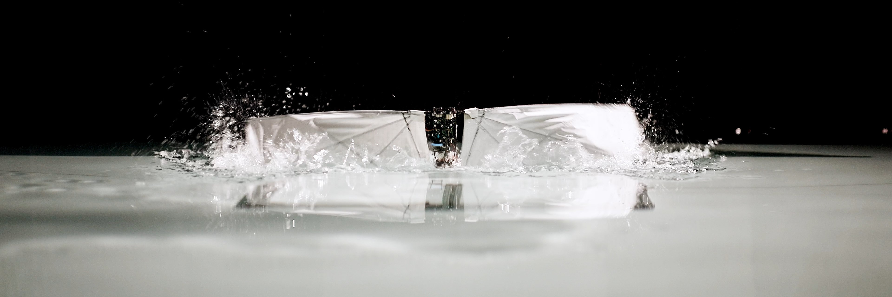

{#fig-faav}

:::: {.content-visible when-format="html"}
::: {.callout-note appearance="simple"}
## Printable manual

Last modified: 2026-09-29

[**Download the printable manual (PDF)**](/files/faav-build-manual.pdf) --- every module and reference page in a single file, for the bench or for printing. Rebuilt automatically whenever the manual changes.
:::
::::

Over the semester you build a **flapping vehicle**: a robot that with the right design can fly and swim by flapping the same wings. The aim of this project is to demonstrate swimming behavior. This manual is the build side of the course. It is sequenced to the weekly modules, and each page covers exactly what you do in that module.

## How this manual is organised

**Build modules** are cumulative and in order.

**Reference** holds the material you consult rather than follow: the parts list, the firmware repositories, and the design notes explaining why the robot is the way it is.

## Semester map

| Module | Week | Build | Paired lecture |
|------------------:|------------------|------------------|------------------|
| [1](/sessions/01-orientation.qmd) | Sep 9 |  | Intro to robotic locomotion |
| [2](/sessions/02-motor.qmd) | Sep 14 | Orientation, teams, the robot. Motor and transmission shaft | Reaction forces in fluids |
| [3](/sessions/03-esc.qmd) | Sep 21 | Motor driver, sensor, serial | Bird-scale flapping design |
| [4](/sessions/04-control.qmd) | Sep 28 | Closed-loop control and tuning | Swimming robots I |
| [5](/sessions/05-frame-crank.qmd) | Oct 5 | Frame, crank, linkage, gears | Undulatory locomotion |
| — | Oct 12 | *No module* | — |
| [6](/sessions/06-simulation.qmd) | Oct 19 | Flapping simulation (Ptera) | Insect-scale flapping |
| [7](/sessions/07-wings.qmd) | Oct 26 | Wing fabrication | Swimming robots II |
| [8](/sessions/08-tail-housing.qmd) | Nov 2 | Tail and housing | Multi-modal locomotion |
| [9](/sessions/09-electronics-dry-test.qmd) | Nov 9 | Flight controller, PCB, dry testing | The future of actuation |
| [10](/sessions/10-waterproofing.qmd) | Nov 16 | Waterproofing | Multirotors |
| [11](/sessions/11-wet-testing.qmd) | Nov 23 | Wet testing | Fixed-wing flyers |
| [12](/sessions/12-competition.qmd) | Nov 30 | Competition | Pair presentations |

## Conventions

::: callout-warning
## Warning

An operation whose likely failure mode destroys a part or injures you. Read it twice before acting.
:::

::: callout-note
## Checkpoint

Do not proceed past this without having completed all the tasks listed.
:::

::: callout-tip
## Why

Design rationale.
:::

## Versioning

This is version **fall-2026**. Corrections published during the semester are dated in the [Changelog](changelog.qmd). If a step here contradicts what we discuss, report it to Raph on slack so the next student does not lose time to it.