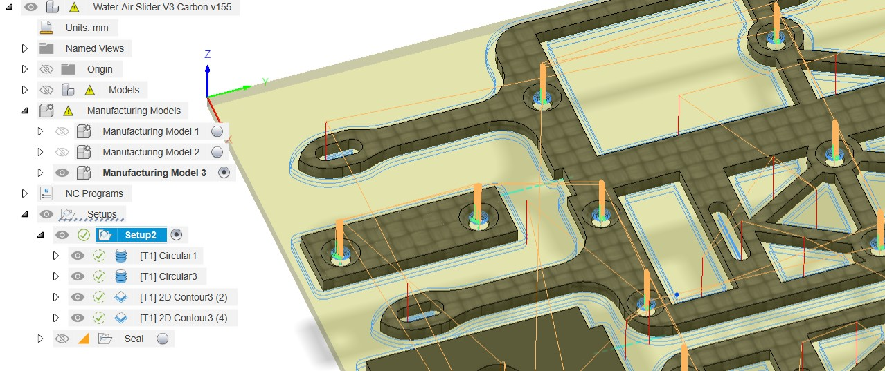
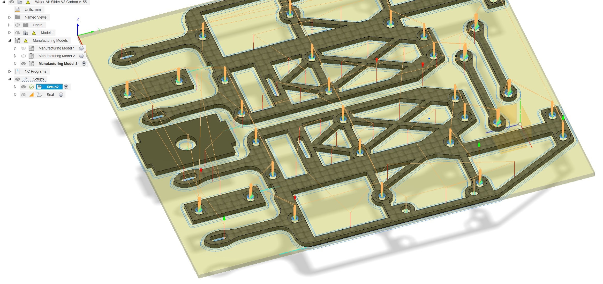

Used in [Session 5](../sessions/05-frame-crank.qmd) for the carbon frame, the
aluminium crank and linkage, and the PEEK gears.

## Full guide

The complete Stepcraft guide is available as a PDF:

- [CNC Stepcraft D600 LIS guide (PDF)](../files/CNC-Stepcraft-D600-guide.pdf)
- Original wiki version: [wiki.epfl.ch/lis/cnc-stepcraft](https://wiki.epfl.ch/lis/cnc-stepcraft)

::: {.callout-warning}
## Before every job

Make sure the **0 of the machine is at the right location in your file**, and
check the orientation of the axes.
:::

## Cutpath generation

Fusion360 generates cutpaths from the parts in the *manufacture* tab, and
allows for *manufacturing models*, where parts can be recombined, realigned and
even modified. Chamfers on the body plates were added in the manufacturing
model rather than in the design.

Operation order: **holes → chamfers → pockets → outline.**

{#fig-cnc-model}

{#fig-cnc-setup}

## Material-specific notes

| Material | Thickness | Notes |
|---|---|---|
| Woven carbon | 1.5 mm (varies 1.5--1.6) | Body plates, top and bottom identical except chamfers |
| Aluminium | 5 mm | Crank and linkage. Linkage faced down from 5 to 4 mm. Use a 2 mm endmill, flood the part |
| PEEK | 5 mm | Gears. Cutting underwater gives good results. Keep advance speed low enough to cut teeth cleanly |

::: {.callout-important}
## MIT equivalent

The linked guide is for the EPFL machine. Confirm which machine the class will
actually use at MIT and either re-shoot this guide or replace the link.
:::
