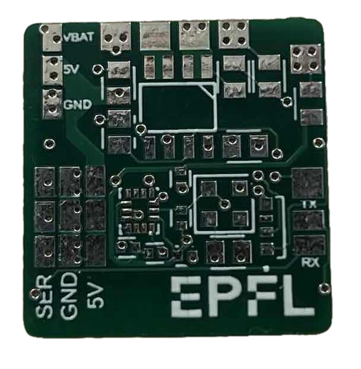
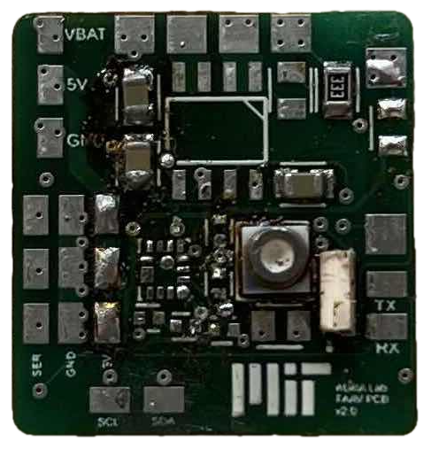
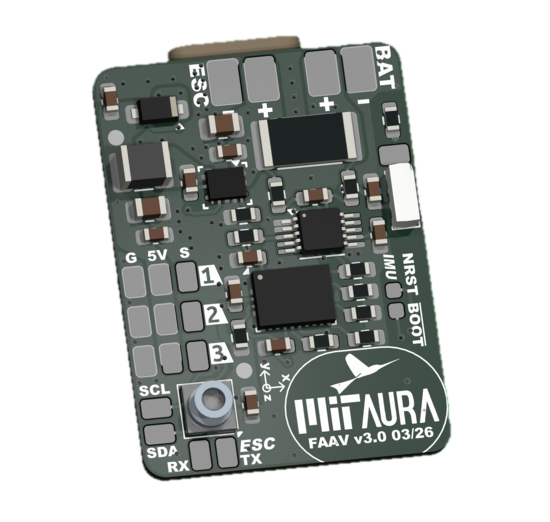
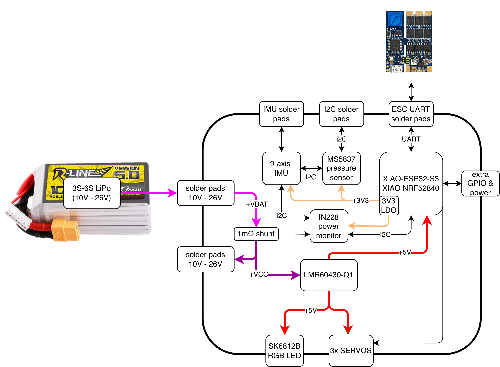
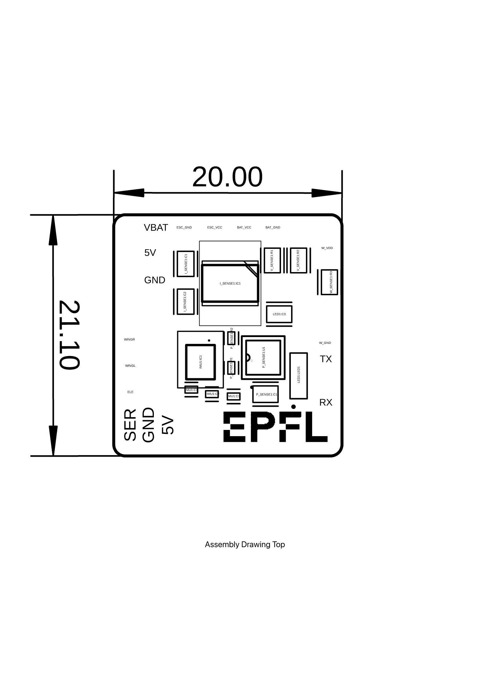
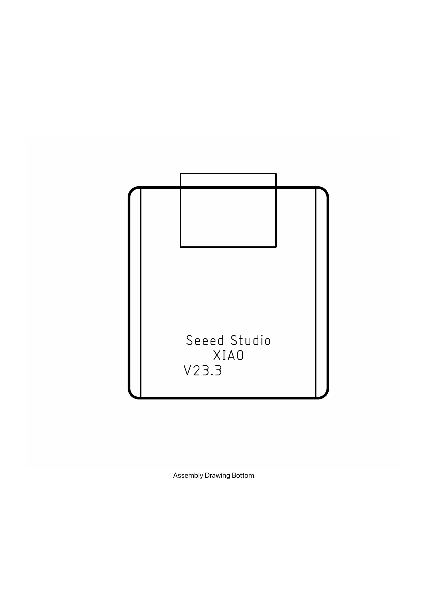
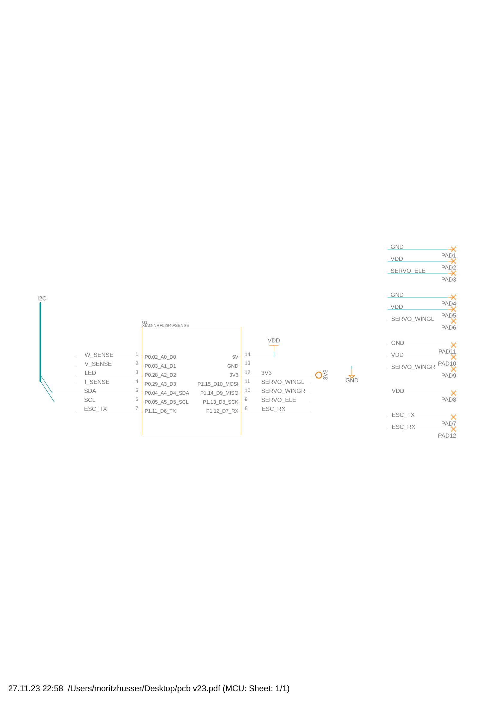
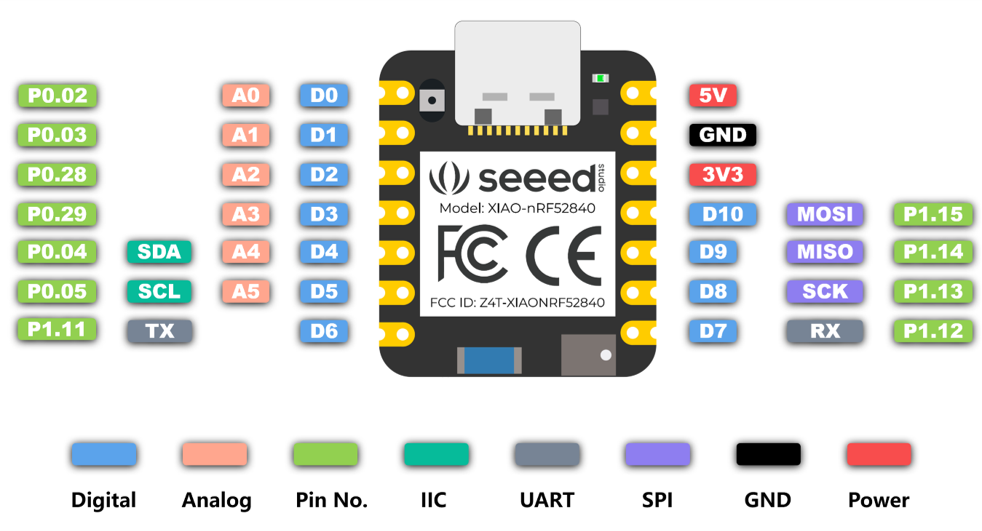

To interface the MCU to the rest of the FAAV, a custom PCB is required. As of
April 2026 the latest board in the FAAV is **v3.0**. More information is in the
[FAAV-PCB-v3 repository](https://github.com/MIT-AURA-Lab/FAAV-PCB-v3).

| Version | Also called | Notes |
|---|---|---|
| v1.0 | EPFL PCB | [Details below](#v1-epfl) |
| v2.0 | MIT PCB | [Details below](#v2-mit) |
| v3.0 | FAAV PCB v3.0 | Current board |

::: {layout-ncol=3}

:::

## v3.0 overview

{#fig-pcb3-block width=75%}

The PCB is 4 layers, 21 × 28.5 mm, and has 34 components. The complete BOM is
in the Manufacturing/Assembly folder of the repository.

Assembly and bring-up are covered in
[Session 9](../sessions/09-electronics-dry-test.qmd).

## v1.0 --- EPFL {#v1-epfl}

A 2-layer PCB. Its purpose is to connect the flight controller to the battery,
ESC and so on, and to provide additional functionality. It was designed with
the Fusion360 PCB designer. The PCB contains a current sensor, a voltage
sensing circuit, a pressure sensor for measuring water depth, water sensing
probes, an LED, an IMU, and several pads for soldering cables. The IMU and
current sensor connect to the MCU over I²C.

::: {.callout-warning}
## Kapton between flight controller and PCB

To prevent short circuits, put a layer of Kapton tape between the flight
controller and the PCB when soldering the Seeeduino to the PCB.
:::

::: {#fig-pcb1-assembly layout-ncol=2}

PCB v1.0 assembly drawings
:::

::: {#fig-pcb1-pins layout-ncol=2}

Pin mapping of PCB pins and flight controller pins
:::

### Component list

| Names | Component description | Supplier | Item number |
|---|---|---|---|
| IMU1:C1 | Capacitor 0.1 µF (0402) | [Mouser](https://www.mouser.ch/ProductDetail/KYOCERA-AVX/KGM05AR51A104KH) | 581-KGM05AR51A104KH |
| I_SENSE1:C1, LED1:C3, P_SENSE1:C1 | Capacitor 0.1 µF (0805) | | |
| P_SENSE1:R1, P_SENSE1:R2 | Resistor 10 k (0402) | [Mouser](https://www.mouser.ch/ProductDetail/Vishay-Dale/CRCW040210K0FKEDC) | 71-CRCW040210K0FKEDC |
| IMU1:C2 | Capacitor 10 nF (0402) | [Mouser](https://www.mouser.ch/ProductDetail/KYOCERA-AVX/KGM05AR71C103KH) | 581-KGM05AR71C103KH |
| I_SENSE1:C2 | Capacitor 10 nF (0805) | | |
| W_SENSE1:R3 | Resistor 1 M (0805) | | |
| IMU1:C3 | Capacitor 2.2 µF (0402) | [Mouser](https://www.mouser.ch/ProductDetail/KYOCERA-AVX/KGM05AR51A225KH) | 581-KGM05AR51A225KH |
| V_SENSE1:R1 | Resistor 330 k (0805) | | |
| V_SENSE1:R2 | Resistor 33 k (0805) | | |
| LED1:LED1 | LED 4691 Adafruit | [Mouser](https://www.mouser.ch/ProductDetail/Adafruit/4691) | 485-4691 |
| I_SENSE1:IC1 | Current sensor ACS723LLCTR-20AU-T, Allegro | [Mouser](https://www.mouser.ch/ProductDetail/Allegro-MicroSystems/ACS723LLCTR-20AU-T) | 250-723LLCTR20AUT |
| IMU1:IC1 | IMU ICM-42688-P, TDK InvenSense | [Mouser](https://www.mouser.ch/ProductDetail/TDK-InvenSense/ICM-42688-P) | 410-ICM-42688-P |
| P_SENSE1:U1 | MS583730BA01-50, TE Connectivity | [Mouser](https://www.mouser.ch/ProductDetail/Measurement-Specialties/MS583730BA01-50) | 824-MS583730BA01-50 |
| I_SENSE1:BAT_GND_REG, I_SENSE1:BAT_VCC_REG | Pin header | | |
| MCU1:U1 | XIAO nRF52840 / Sense, Seeed Studio | | |

: PCB v1.0 components {#tbl-pcb1}

## v2.0 --- MIT {#v2-mit}

The goal of this version was to fix existing functional problems (I²C, pad
spacing) and to introduce a new external I²C pad for GPS functionality. It is
also designed to function by default with both the newer ESP32S3 chips and
NRF52 chips. Improvements in range through WiFi connection are expected.
**Manufacturing steps are identical to v1.0.**

### ESP32 compatibility

Hardware and software arrangements were needed for
[XIAO ESP32S3](https://wiki.seeedstudio.com/xiao_esp32s3_getting_started/)
compatibility. For software see [Software](software.qmd).

Hardware changes: a new PCB housing part allowing SD card removal and
reinsertion, a WiFi antenna housing case, and a GPS housing case.

**SD card notes**

1. SD cards should be formatted to a specific format (FAT32, believed).
2. Use non-sharp tweezers to gently extract the SD card from the PCB case ---
   otherwise you risk breaking the card and making it unreadable.
3. For simultaneous servo and SD card usage, be careful not to use the same
   pins as on the previous chip for servos; TX and RX are used for SD card
   communication. You may use the secondary microSD card PCB's two additional
   pins.

### Waterproofing {#v2-waterproofing}

The method changes slightly from [Session 10](../sessions/10-waterproofing.qmd).
Admittedly it can be vastly improved, but it works:

1. Insert the assembled PCB, making sure the secondary SD card PCB does not
   come loose, and that the WiFi antenna is properly inserted.
2. Insert the USB-C cable into the port, and a microSD card in the relevant
   slit.
3. Tape the bottom of the PCB so no silicone escapes when pouring. Pour
   silicone, using a needle to ensure there are no air bubbles between layers.
4. When fully cured, the SD card is very hard to remove if the protective
   section broke off during assembly. It can be salvaged by cutting around
   three sides of the SD card with a knife and opening it like a trap door,
   freeing the stuck sections. The trap door can then be sealed with epoxy or
   more silicone --- only on the surface, as you do not want to block the SD
   card again.

The WiFi antenna should also be potted. Currently the same housing case as for
the ESC is used: tape the bottom of the box with Kapton tape, stick the antenna
to the bottom of the casing (normally all in sticker form), then pot it with
silicone. The silicone layer should be left relatively thin.

::: {.callout-note}
## The antenna stops working when wet

It works again once dried. This is expected behaviour, not a fault.
:::

### Points for a redesign

- Incorrect wiring for pressure sensor --- SDA and SCL are swapped.
- Cover the vias (currently open vias).
- Vias on pads of small SMD components are not optimal for soldering, or just
  cover the vias.
- Increase pad spacing for the cables.
- Current sensor: possibly change to a 3.3 V part. Currently a 5 V sensor is
  used, so current should not exceed
  $(3.3\,\mathrm{V} - 0.5\,\mathrm{V}) / 0.2\,\mathrm{V/A} = 14\,\mathrm{A}$
  without risking damage to the analog ports of the Seeeduino.
- ~~UART RX and TX are swapped~~ *(resolved)*
