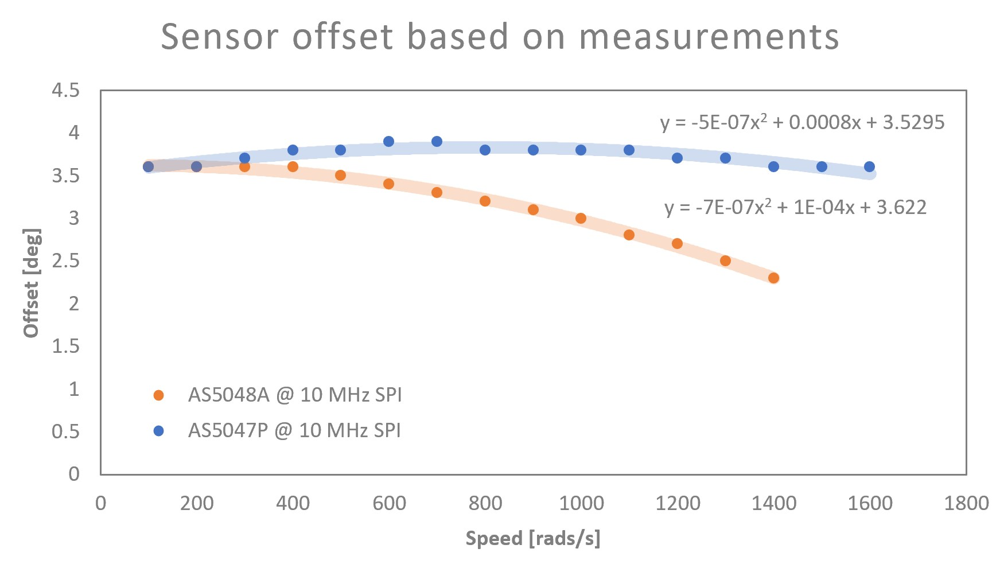
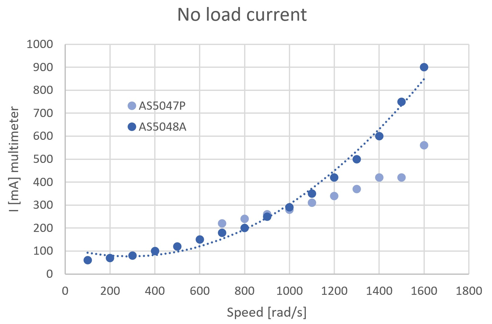

::: {.session-meta}
**Week of Sep 28** · Paired lecture: *Swimming robots I*
:::

## What you build today

The gearbox installed with a marker flag on the output, running continuously,
then holding position, then tracking a velocity setpoint with a tuned loop.

## Before you arrive

| | |
|---|---|
| **Parts** | Assembled motor + gearbox from [Session 2](02-motor.qmd), ESC from [Session 3](03-esc.qmd) |
| **Tools** | Bench supply with current limit, tachometer or camera |
| **Read** | This page in full --- the speed limits below explain most of what you will hit |

## Task sequence

1. Mount a small flag on the gearbox output so rotation is visible and
   countable.
2. Achieve continuous spinning at low speed.
3. Achieve position control --- the output holds against a hand disturbance.
4. Tune the loop and characterise your maximum usable speed.

::: {.callout-important}
## To be completed by the instructor

The specific PID tuning exercise, the target performance, and the sign-off
criteria are course material and are not in the manufacturing guide.
:::

## Why low speed is the hard part

Regular drone ESCs start **losing synchronisation at low speed**, which is
exactly the regime used for water propulsion. That is the reason this course
uses an FOC ESC rather than a hobby unit --- see
[Design notes](../reference/design-notes.qmd).

## Going beyond 600 rad/s

Two issues limit speed: the micro-controller loop rate, and delays from the
rotation sensor, which also feed back into the first. The changes below
improved maximum speed from **500 to 1700 rad/s**, enough to drive the wings at
10 Hz. At very high speeds sensor lag becomes the binding constraint, and shows
up as high current draw and noise.

### Sensor speed

- Switch to an **SPI sensor**. SPI is faster than I²C or PWM. There is no SPI
  link directly exposed on the board --- the solution is the SPI3 bus, wired as
  in [Session 3](03-esc.qmd#tbl-spi3).
- Increase SPI bus speed to **10 MHz**.
- Use the **AS5047P** sensor, rated for speeds up to 28 kRPM.

### MCU speed

The goal is to maximise main loop frequency, which reached **13 kHz**. Read the
current loop frequency with the commander's `F` command.

| Change | Effect |
|---|---|
| `motor.motion_downsample = 3` | +0.8 kHz loop frequency |
| Disable monitoring | +0.2 kHz |
| Switch to SVPWM | No improvement observed. May help, unconfirmed |
| `L = 0.0001` | Tuning the inductance value helped --- made voltage mode work much better |

### Sensor lag

Compensating sensor lag as speed increases is necessary to go above 500--600
rad/s without wasting current. It is currently hand-tuned every 100 rad/s, and
a fitted function is used on the robot. This could be automated by ramping
through the speeds and minimising phase current --- future work. This
[SimpleFOC forum thread](https://community.simplefoc.com/t/challenges-going-faster-than-certain-rpm/1688/39)
is useful on the topic.

{#fig-sensor-offset}

{#fig-esc-current}

::: {.callout-tip}
## Averaging current measurements

When using the ESC's current measurements ($I_{DC}$, $I_d$, $I_q$, $I_u$,
$I_v$, $I_w$), always average over a time window --- the raw measurements are
noisy.
:::

::: {.callout-note}
## Checkpoint --- TA sign-off

Continuous low-speed rotation without loss of synchronisation, position hold
against a hand disturbance, and a recorded loop frequency from `F`.
:::
