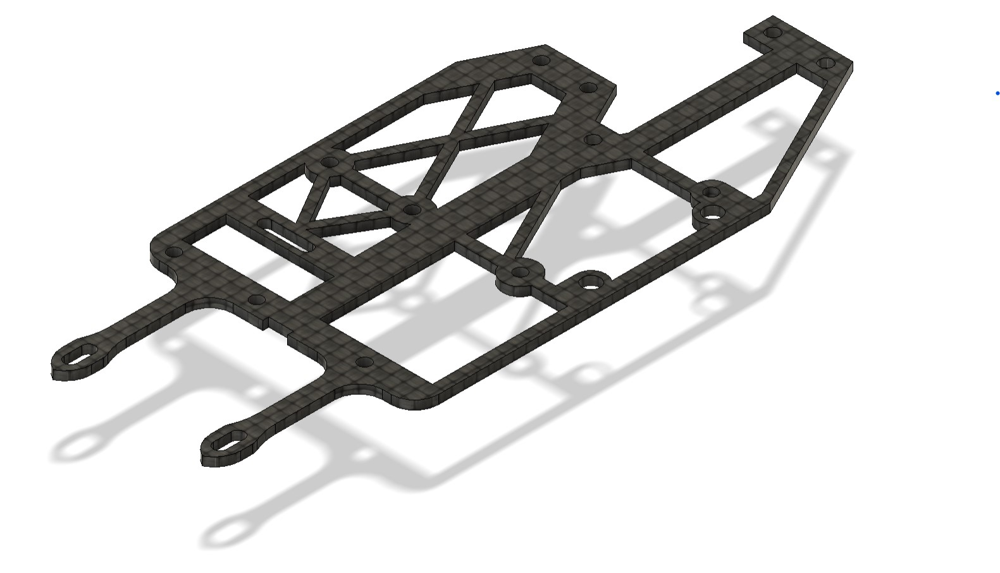
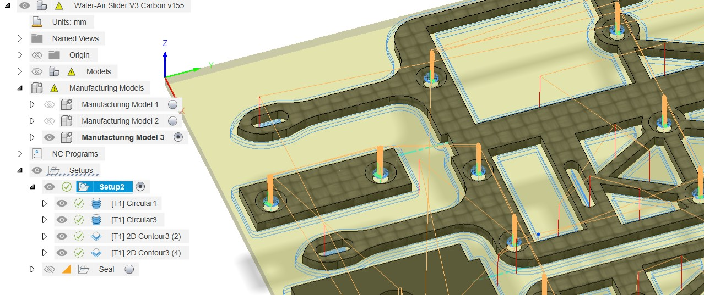
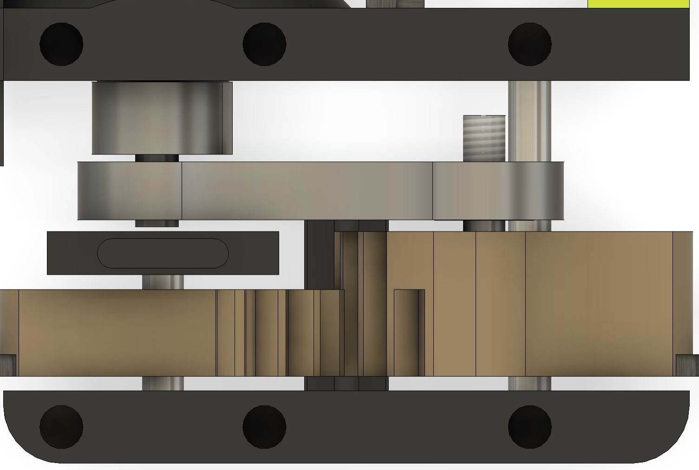
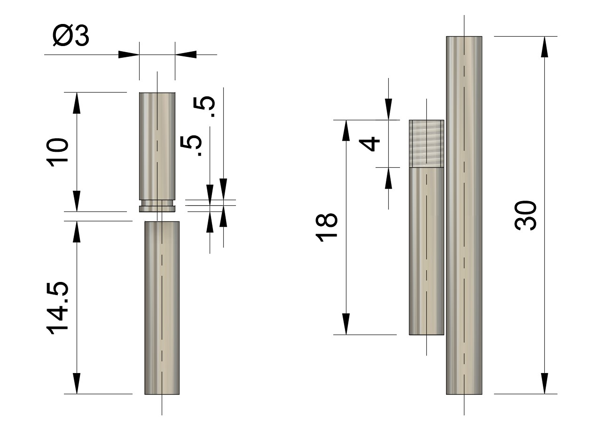
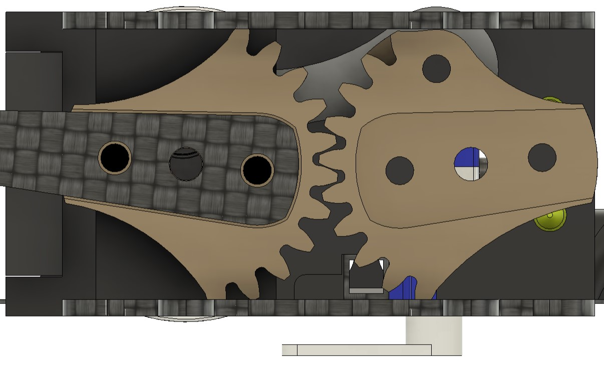
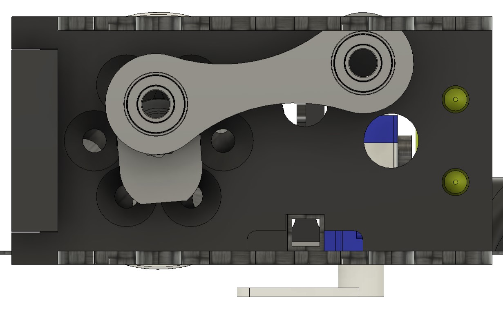

::: {.session-meta}
**Week of Oct 5** · Paired lecture: *Modelling of undulatory locomotion*
:::

## What you build today

The carbon frame, the CNC-cut crank and linkage, the PEEK gears, and the full
mechanical integration that turns motor rotation into flapping. Flapping
amplitude is fixed by this design.

## Before you arrive

| | |
|---|---|
| **Parts** | 1.5 mm woven carbon plate, 5 mm aluminium plate, 5 mm PEEK plate, bearings, M2×4 screws, brass inserts |
| **Tools** | CNC (booked), drill press, M3 tap, cutting oil, metal glue |
| **Read** | This page, plus the [CNC guide](../reference/cnc.qmd) if you have not run the Stepcraft before |

## Main body

The main body is a carbon sandwich, spaced **24 mm** apart. The plates are
CNC-cut from woven 1.5 mm plates, available from
[swiss-composites](https://shop.swiss-composite.ch/pi.php/Halbfabrikate/Plattenmaterial/CFK-Prepreg-Platten/Carbon-Prepreg-Platten-15mm.html);
thickness usually varies from 1.5 to 1.6 mm. The top and bottom plates are
identical, except for the chamfers needed for the M2 screws. The screws holding
plate to plate are **M2×4**, screwing into brass inserts.

{#fig-frame width=55%}

Fusion360 generates cutpaths from the parts in the *manufacture* tab and allows
for *manufacturing models*, where parts can be recombined, realigned and even
modified. Here, chamfers were added in the manufacturing model. Operations go:
**holes first, then chamfers, then pockets, and finally the outline.**

{#fig-manufacturing}

::: {.callout-warning}
## Check your zero before you cut

Make sure the machine's 0 is at the right location in your file, and check the
orientation of the axes. Full CNC guide for the Stepcraft D660 is in the
[CNC reference](../reference/cnc.qmd).
:::

## Crank and linkage

Dimensions differ between robot generations --- check which one you are
building:

| | FAAV3.2 | FAAV4 |
|---|---|---|
| Date | 2023 | July 2024 |
| Crank radius | 4 mm | 4.5 mm |
| Linkage length | 23 mm | 24 mm |
| Crank–linkage shaft diameter | 3 mm | 4 mm |
| Bearing, crank side | 10×3×4 | 10×4×4 |
| Bearing, wing side | 8×3×4 | 8×3×4 flanged |

: Crank–linkage dimensions {#tbl-crank}

Both the crank and linkage are CNC-cut in a 5 mm aluminium plate. The linkage
is only 4 mm thick, cut down from 5 mm with a facing operation on the CNC. Use
a **2 mm endmill**. Flooding the part keeps the temperature down and gives good
results.

Once cut:

1. Manually drill a **2.5 mm** bore hole into the crank, perpendicular to its
   4 mm hole and to the flat raised surface. Drill through the part all the way
   to the 4 mm hole.
2. Carefully tap an **M3** thread. Use cutting oil and make sure to break off
   the chips.

   ::: {.callout-warning}
   ## This thread carries high forces

   It **must** be done carefully, keeping the alignment between hole and tap.
   :::

3. Press the bearings into the linkage. They may need to be bonded with metal
   glue if the press fit is not good enough.
4. Join the crank and linkage with a short 3 or 4 mm shaft, cut to **9.5 mm**.
   The bearing is kept from coming out with a pointy indent on the shaft end.
   *(To be improved.)*

::: {.callout-warning}
## Alignment of the linkage, perpendicular to the shafts, is extremely important

An offset of **1 mm** is sufficient to destroy the crank-link in a few flights.
To ensure forces are not applied radially, use circular offsets (not shown in
the schematics) that fit around the shafts and support proper alignment of the
linkage and shafts.
:::

@fig-shafts shows how the four shafts for the FAAV3.2 should be manufactured.
Nothing exotic, but they need to be accurate.

::: {#fig-shafts layout-ncol=2}

Shafts
:::

## Gears

Cut in **5 mm PEEK** plastic --- a high-performance plastic suited to hard
environments and high temperatures. The 5 mm plate comes from RS Components.
Cutting underwater again gives good results. Keep the advance speed low enough
to cut the teeth cleanly.

The primary gear consists of **2 parts**, stacked and screwed together. The
3 mm holes where the carbon is fixed need to be **tapped** with a sharp M3 tap.

::: {.callout-tip}
## Keep the tap normal to the surface

Best done in the drill press, which keeps the tap aligned.
:::

The 3 mm shaft is pressed through the two gears' centre holes --- a mildly
tight fit at minimum, otherwise glue the shaft. Same for the linkage shaft
(also 3 mm), which should be bonded as well as possible; this one matters more,
so use glue in all cases.

Between the gears, a clearance of **0.4 mm** (inter-axis spacing of 25.4 mm)
ensures proper operation without too much backlash.

::: {layout-ncol=2}

:::

::: {.callout-note}
## Checkpoint --- TA sign-off

Frame assembled, crank–linkage rotating freely through a full cycle with no
binding, linkage visibly perpendicular to the shafts, and gear backlash checked.
:::
