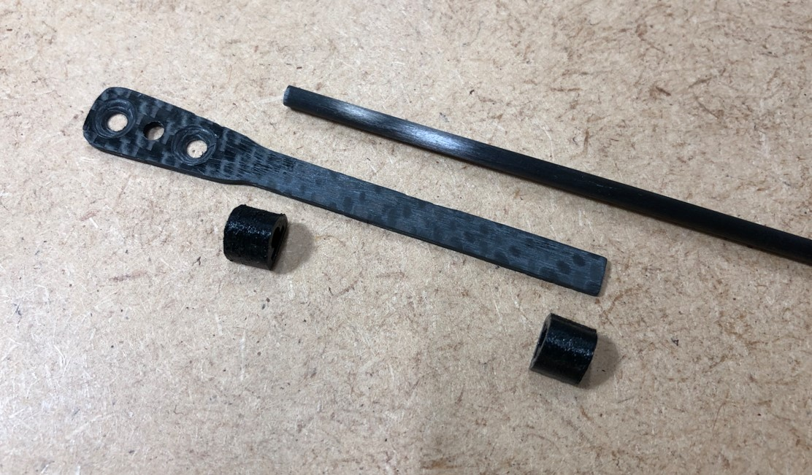
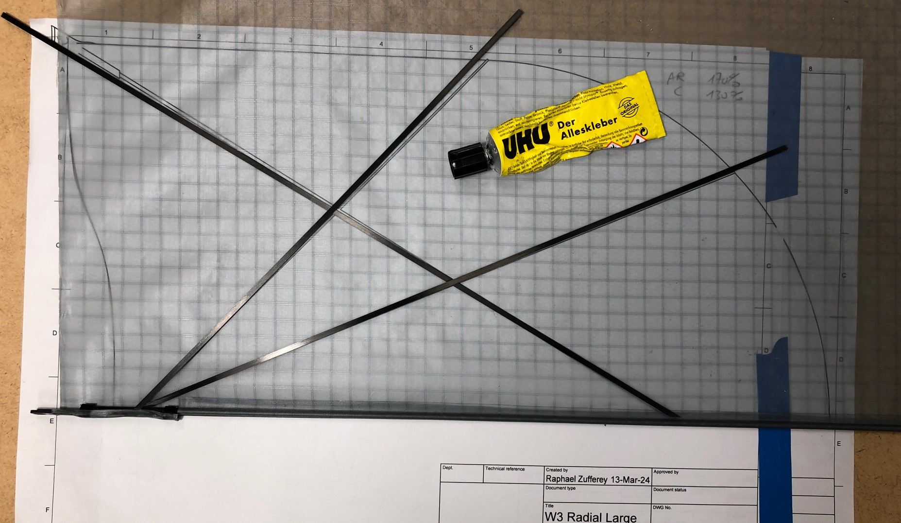
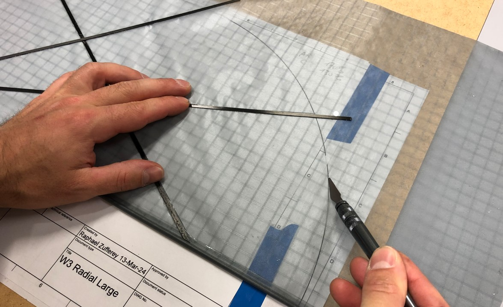
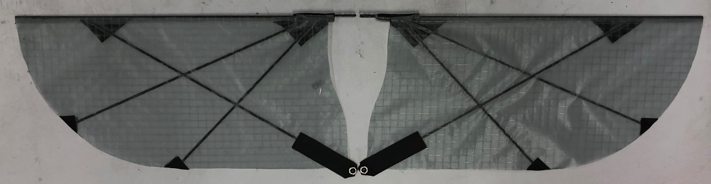

::: {.session-meta}
**Week of Oct 26** · Paired lecture: *Swimming robots II*
:::

## What you build today

Both wings: carbon skeleton, membrane cut to the geometry you chose in
[Session 6](06-simulation.qmd), bonded and stitched at the load-bearing points.

## Before you arrive

| | |
|---|---|
| **Parts** | Carbon rods and strips, wing-root fittings, membrane material, glue |
| **Tools** | Cutting mat, steel rule, scalpel, printed full-size template of your geometry |
| **Bring** | Your Session 6 geometry, printed 1:1 |

## Wing roots

The wing roots are carbon, drilled to mate with the linkage bearings from
[Session 5](05-frame-crank.qmd).

{#fig-wing-roots width=70%}

## Laying out and cutting the membrane

Work over the full-size printed template, taping the spars in position before
cutting the membrane to the outline.

::: {layout-ncol=2}

:::

## Completed wings

{#fig-wings-complete}

::: {.callout-warning}
## Both wings must match

Asymmetry between left and right shows up as a roll bias you will spend
[Session 11](11-wet-testing.qmd) trimming out. Weigh both wings and compare
spar positions against the template before bonding.
:::

::: {.callout-important}
## To be written by the instructor

The manufacturing guide documents this step **with photographs only** --- there
is no written procedure in the source. The images above are in build order, but
the following still need writing:

- Membrane material and its supplier
- Adhesive, and cure time
- Which areas are stitched, and with what
- Spar layup: rod diameters, where the diagonals attach
- Tolerance between left and right wing
:::

::: {.callout-note}
## Checkpoint --- TA sign-off

Both wings complete, matched in mass and geometry, roots fitting the linkage
bearings without play.
:::
